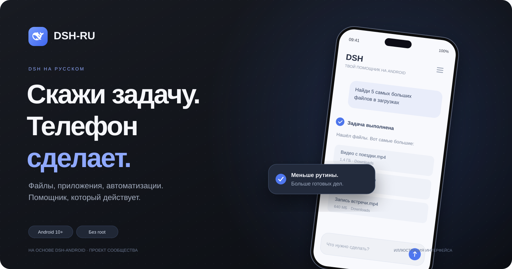
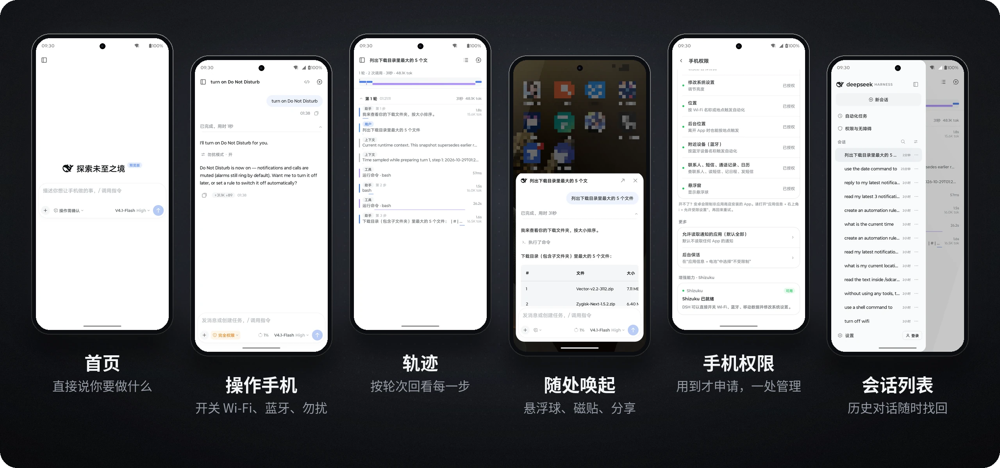
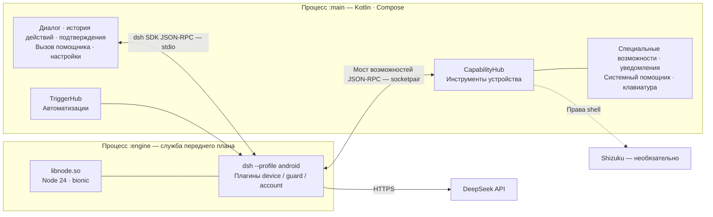

<div align="center">



<br />

**Форк [DSH-Android](https://github.com/jackwener/DSH-Android) от jackwener с переводом интерфейса на русский язык.**

Без root и компьютера — прямо на вашем Android. Помощник, который выполняет задачи на телефоне за вас.

Запускает [DeepSeek Harness](https://github.com/deepseek-ai/deepseek-harness) (dsh) на Android: управляет приложениями, упорядочивает файлы, меняет системные настройки и выполняет автоматизации.

[](../../releases/latest)


[](LICENSE)

**[Скачать APK](../../releases/latest)** • **[Быстрый старт](#быстрый-старт)** • **[Архитектура](#архитектура)** • **[Сборка из исходников](#разработчикам)**

</div>

> **Установка и обновление.** Сборка подписана отдельным ключом и не устанавливается поверх официального DSH. Удаление установленного приложения может привести к потере данных. С версии `0.3.6-ru.1` можно обновиться с сохранением подписи. Установка рядом пока не реализована.

<details>
<summary><b>Сборка и проверки</b></summary>

Текущий релиз — `0.3.7-ru.1`, versionCode `27`. Приложение и пакет движка собраны из исходников через GitHub Actions; нативные библиотеки загружены из проверенной сборки DSH-Android. [Журнал сборки](https://github.com/Strokln/Stroka/actions/runs/41410305714).

Проверены подпись, выравнивание APK, XML, регистрация языков и параметры форматирования строк. Контрольная сумма SHA-256 приложена к [релизу](../../releases/latest). Установка и голосовой ввод на реальном телефоне пока не проверялись. Для голосового ввода нужна служба распознавания Android с поддержкой русского языка.

</details>

---

## Главное

- **Помощь в привычных приложениях:** ставьте задачи вроде «Подготовь ответ в Telegram», «Сравни объявления на Avito», «Найди подходящие вакансии на hh.ru» или «Собери заметки из VK». Агент взаимодействует с приложениями через экран; выполнение зависит от их интерфейса и доступных разрешений.
- **Агент работает, а вы продолжаете пользоваться телефоном:** после выдачи разрешений он может читать экран, нажимать, вводить текст и прокручивать. В любой момент можно поставить задачу на паузу, остановить её или добавить уточнение. На Android 14 и новее поддерживается работа на виртуальном экране: после настройки Shizuku или подключения ADB к самому устройству агент не занимает ваш экран.
- **Вызов из любого приложения:** общайтесь и ставьте задачи через плавающую кнопку. Можно отправить текущий экран и спросить: «Что ответить?» или «Помоги это записать».
- **Linux-среда внутри телефона:** агент может запускать Python, обрабатывать отправленные файлы и выполнять написанные им скрипты.
- **Доступ к агенту на компьютере вне дома:** подключайтесь к DSH на компьютере или сервере через SSH или DSH Remote. Если нужен только удалённый режим, устанавливать локальную среду выполнения на телефон не требуется.

## Обзор интерфейса



<sub>На скриншотах показан китайский интерфейс. Обложка выше — иллюстрация.</sub>

## Быстрый старт

1. Скачайте APK из [Releases](../../releases/latest) и установите его: arm64, Android 10 или новее. Язык выбирается в разделе **Настройки → Общие → Язык → Русский**.
2. Войдите в учётную запись DeepSeek или укажите [API-ключ](https://platform.deepseek.com/api_keys). Других провайдеров можно добавить в разделе **Настройки → Сервисы моделей**.
3. Просто скажите, что нужно сделать, например: «Покажи пять самых больших файлов в загрузках». Если задаче понадобится разрешение, приложение подскажет, как его выдать.
4. Необязательно: установите Shizuku одним нажатием в разделе **Настройки → Разрешения телефона**. В Shizuku включите «Запуск при загрузке (беспроводная отладка)».

## Возможности

- **Файлы:** поиск, упорядочивание, перемещение, переименование, сжатие и распаковка; чтение текста из PDF, Word, Excel и PowerPoint.
- **Экран и приложения:** чтение экрана, нажатия, жесты и ввод через службу специальных возможностей; запуск приложений и переход на определённые страницы.
- **Системные настройки:** яркость, громкость, режим «Не беспокоить», будильники, Wi-Fi, Bluetooth и местоположение; чтение уведомлений и ответы на них, управление воспроизведением.
- **Автоматизации:** выполнение по расписанию или при подключении к Wi-Fi/Bluetooth, начале зарядки, прибытии в определённое место, получении уведомления и других событиях.
- **Сервисы моделей:** DeepSeek, OpenAI, Claude, Gemini, OpenRouter, Qwen и другие провайдеры с совместимым интерфейсом. Укажите API-ключ и получите список моделей — затем они появятся в переключателе.
- **Возможности dsh:** навыки, MCP-серверы, подагенты, поиск в интернете и выполнение команд.
- **Без root и Termux:** достаточно установить APK. Shizuku необязателен и открывает доступ к дополнительным системным переключателям.

## Архитектура



- **Движок встроен в процесс приложения:** Node 24 собран в нативную библиотеку Android и запускается через JNI в службе переднего плана `:engine`. Не нужны proot и Termux; ограничения на «фантомные процессы» Android 12 и новее не затрагивают эту схему.
- **Связь с движком через SDK:** приложение взаимодействует с dsh через SDK-протокол. Адаптация под Android вынесена в плагины и небольшой набор патчей.
- **Функции телефона реализованы в приложении:** инструменты устройства написаны на Kotlin и доступны движку через приватный сокетный канал. Подробнее — в [контракте движка](docs/ENGINE-CONTRACT.md).

## Системные требования

Android 10 или новее, arm64-v8a. APK занимает около 96 МиБ. Рекомендуется не менее 500 МБ свободного места. Для использования DeepSeek нужен доступ к его API.

## Если приложение не устанавливается

- **«Пакет не подписан» или «Нет файла подписи»:** текущий APK содержит подписи v1, v2 и v3. Скачайте файл напрямую из Releases и убедитесь, что загрузка завершилась полностью.
- **«Ошибка разбора пакета»:** вероятно, файл скачан не полностью или получил другое расширение при передаче через мессенджер, например `.apk.1`. Скачайте его заново из Releases и сверьте SHA-256 с описанием выпуска.
- **«Подпись не совпадает с установленным приложением»:** установлена версия с другой подписью — например, официальная, собственная или из другого источника. Обычное обновление невозможно. Удаление перед установкой очищает данные приложения.
- **«Несовместимо с устройством»:** поддерживаются только телефоны с Android 10 и новее и архитектурой arm64-v8a.
- **«Вредоносное приложение заблокировано»:** см. следующий раздел.

## Предупреждение «Вредоносное приложение заблокировано»

DSH-Android распространяется вне Google Play и использует специальные возможности, доступ к уведомлениям, SMS и другие функции. Google Play Защита может показать предупреждение. Проверьте источник файла и соответствие SHA-256 описанию релиза. Доступны следующие способы установки:

- **На телефоне:** в предупреждении нажмите «Подробнее», затем «Всё равно установить». Кнопка «Понятно» отменяет установку.
- **Через `adb install`:** команда может ждать без вывода, пока на телефоне открыт запрос подтверждения — проверьте экран. Проверку ADB-установок можно временно отключить командой `adb shell settings put global verifier_verify_adb_installs 0` и обязательное восстановление значения `1` после установки.

## Текущие ограничения

- **Управление другими приложениями на заблокированном экране:** при защищённой блокировке система не разрешает взаимодействовать с их интерфейсом. Такие задачи приостанавливаются до разблокировки. Задачи через системные API — файлы, настройки, уведомления — продолжают работать.
- **Повторный запуск Shizuku после перезагрузки:** рекомендуется включить «Запуск при загрузке (беспроводная отладка)». Требуются Shizuku 13.6 или новее и Android 11 или новее.
- **Прошивки производителей:** на некоторых устройствах нужно вручную разрешить фоновое открытие окон и автозапуск, чтобы плавающая кнопка и фоновые автоматизации работали стабильно. Страница проверки состояния подскажет нужные настройки.
- **Сторонние модели:** нужен сервис с совместимым интерфейсом Chat Completions. Поиск в интернете предоставляет DeepSeek; при использовании другой модели для поиска нужен дополнительный API-ключ DeepSeek. Качество вызова инструментов зависит от выбранной модели.
- **Холодный запуск:** первый запуск движка занимает около пяти секунд; оптимизация продолжается.

## Разработчикам

<details>
<summary><b>Сборка из исходников</b></summary>

Требуются JDK 21, Android SDK с compileSdk 37.2 и NDK r29. При сборке на Linux arm64 дополнительно передайте `-Pandroid.aapt2FromMavenOverride=<путь к aapt2 для arm64>`.

```bash
# 1. Нативные библиотеки, включая libnode:
# скачать готовые сборки и проверить хеши — собирать Node самостоятельно не нужно
native/prebuilt.sh fetch            # → toolchains/out/jniLibs/arm64-v8a/

# 2. Пакет движка: dsh + плагины + патчи → engine.zip
OUT_DIR=<engineOut> js/build-engine.sh

# 3. APK
./gradlew :app:assembleDebug -Pdsh.engineOut=<engineOut>
```

- Тег готовых нативных компонентов состоит из версии Node и хеша всех нативных патчей, например `native-node24.22.1-caacecde44`. Пересборка нужна только при обновлении Node или изменении этих патчей: выполните `native/build.sh`, затем опубликуйте результат через `native/prebuilt.sh publish`.
- Сквозные тесты на компьютере с реальными обращениями к DeepSeek API: `node js/test/host-e2e.mjs`. Сохраните API-ключ в файле и укажите путь через переменную `DSH_E2E_KEY_FILE`; по умолчанию используется `~/.config/dsh/deepseek_api_key`.

</details>

<details>
<summary><b>Структура каталогов</b></summary>

```text
app/        Android-приложение — Kotlin · Compose · Hilt · Room
  core/engine/       Процесс движка, запуск JNI, восстановление после сбоев
  core/capability/   Инструменты телефона: файлы, экран, система, уведомления, медиа
  core/trigger/      Правила автоматизации и источники событий
  feature/          Интерфейс: диалог, история действий, быстрая панель, автоматизации, настройки, вход
js/         Профиль android для dsh, плагины и патчи; build-engine.sh → engine.zip
native/     Node 24 для Android, обёртка JNI, нативные плагины, скрипты готовых сборок
tools/      Генерация строк, значков, обложки README и манифеста обновлений
update/     latest.json — список обновлений приложения; см. docs/RELEASE.md
docs/       Архитектура, контракт движка, параметры оформления, скриншоты
```

</details>

<details>
<summary><b>Перевод и добавление языков</b></summary>

`app/src/main/res/values/` содержит китайский язык по умолчанию, `values-en/` — английский. `values-ru/` содержит русский язык. Чтобы добавить другой язык:

1. Создайте `app/src/main/res/values-<код языка>/`, скопируйте все `strings*.xml` из `values-en/` и переведите их. Проверка lint `MissingTranslation` укажет пропущенные записи.
2. Добавьте `<locale android:name="<код языка>" />` в `app/src/main/res/xml/locales_config.xml`.

Меню **Настройки → Общие → Язык** и системная настройка языка приложения Android 13+ используют этот список. Дополнительные изменения кода для списка языков не нужны. Тест `LocalesConfigTest` проверяет согласованность. Переменная движка `DSH_ANDROID_LOCALE` следует языку приложения.

</details>

<details>
<summary><b>Документация по устройству приложения</b></summary>

- [Архитектура](docs/ARCHITECTURE.md)
- [Контракт движка — приложение ↔ dsh](docs/ENGINE-CONTRACT.md)
- [Параметры оформления](docs/design-tokens.md)
- [Процесс выпуска, включая манифест обновления update.json](docs/RELEASE.md)

</details>

## Благодарности

- [jackwener / DSH-Android](https://github.com/jackwener/DSH-Android) — оригинальное Android-приложение и исходный README.
- [DeepSeek Harness](https://github.com/deepseek-ai/deepseek-harness) — движок агента.
- [Node.js](https://nodejs.org); при сборке для Android использованы подходы [Termux](https://github.com/termux/termux-packages) и [nodejs-mobile](https://github.com/nodejs-mobile/nodejs-mobile).
- [Shizuku](https://github.com/RikkaApps/Shizuku), Apache-2.0 — в приложение включён официальный установочный пакет.
- [ripgrep](https://github.com/BurntSushi/ripgrep).
- [dsh-llm-service-lite](https://github.com/snnh/dsh-llm-service-lite), MIT, snnh — адаптер сторонних моделей, включён без изменений в `js/packages/llm-service-lite/`.
- [magpie](https://github.com/yetone/magpie), MIT — предустановленные адреса провайдеров и подходы к подключению dsh: группировка по протоколам, maxTokens и пороги сжатия.

## Правовая информация

Это проект сообщества, не связанный с компанией DeepSeek и не одобренный ею. DeepSeek и другие товарные знаки принадлежат соответствующим правообладателям.

## Лицензия

[Apache License 2.0](LICENSE). Встроенные сторонние компоненты — Node.js, dsh, dsh-llm-service-lite, Shizuku, ripgrep и другие — распространяются по собственным лицензиям.
